# Microgrid Dispatch Based on Genetic Algorithm (Wind, Solar Power, Battery, Micro-Gas Turbine) (Matlab Code Implementation)

​  
References
Editor
Microgrids, as a part of the smart grid, are an effective means for distributed power sources to connect to the grid. The economic operation of microgrids is one of the important research areas. Examining the economic viability of microgrids typically involves multi-objective optimization from two aspects: minimum operational cost and minimum environmental pollutant emissions. By assigning weight coefficients to the fitness function, the multi-objective functions are converted into single-objective functions. A simulation study was conducted on specific microgrid systems, and the results show that the weight coefficient method can achieve a relatively balanced state between economic costs and environmental costs, realizing the economic operation of microgrids. 1 Introduction Globally, countries are facing energy shortages, and various renewable energies have received widespread attention. Microgrids (Micro-Grids) are an integral part of the smart grid.
The emergence of the Grid provides a method for integrating these renewable energy sources.
(such as photovoltaic, wind power generation, etc.) A system that can provide both thermal energy and electrical energy simultaneously. Microgrids have two operational modes: grid-connected and islanded.
The smooth transition between two modes of operation [2] enhances the reliability of microgrid operation and effectively reduces power generation costs.
The microgrid in this paper includes micro-gas turbine (MT), fuel cell (FC), photovoltaic (PV), wind turbine (WT), and battery storage (SB). A combined heat and power type microgrid model is established. For the grid-connected operation of the microgrid, a genetic algorithm is used to optimize multiple objectives.
Optimization. Utilizing a strategy of "thermal to electrical," the first step is for the gas turbine (MT) to meet the user's heat demand while also providing electricity.
The objective function is to minimize the economic cost and the environmental pollution emission cost by using renewable energy power generation.
Transform multi-objective functions into single objective functions, and implement the economic operation of microgrids based on specific examples.
2 Microgrid Power Source Model 1.1 Micro-gas turbine (MT) Micro-gas turbine utilizes natural gas, Biogas and various fuels provide heat energy and electricity. Combined cooling, heating and power system for gas turbines
(CCHP) schematic diagram is shown in Figure 1. The high-temperature, more available energy is used for power generation, while the low-temperature is passed through lithium bromide
The unit is used for cooling or heating, which improves energy utilization efficiency and contributes to enhancing economic and environmental benefits.
Editor
Figure 1: Sketch of a micro gas turbine's combined cooling, heating and power
Editor
1.2 Fuel Cell (FC) A fuel cell is a device that converts chemical energy into electrical energy, not subject to the limitations of the Carnot cycle, with high energy conversion efficiency, clean operation, and low noise.
Therefore, it is very suitable for distributed power generation. The cost of fuel cell power generation is:
Editor
1.3 Photovoltaic (PV) cells convert solar energy into direct current electricity, which is a type of non-linear electrical energy, with voltage and current varying with the intensity of light and temperature.
The changes exhibit non-linearity. The output power is:
Editor
Editor
1.4 Wind power generation (WT) involves converting the energy obtained from wind turbines' blades into mechanical energy, which is then transmitted to generators to produce electricity.
Yes, therefore the cost of wind power fuel and gas emission treatment is 0. The output power of wind turbine generators is related to wind speed:
Editor
1.5 In the SB microgrid, the charging and discharging processes of the batteries alternately occur. Once the charging reaches its rated capacity, it enters the discharging process, which continues until the SOC is reached.
(Charge state) When the charge is 30% of rated capacity, stop discharging and enter charging.
2. Operational Optimization of Microgrids
Editor
Editor
2.2 Constraints - Edit
3. Genetic Algorithm (Genetic Algorithm) is a method for searching the optimal solution through mimicking the natural evolution process.
Multi-objective Genetic Algorithm (MOGA) refers to the optimization of multiple objectives simultaneously, seeking a set of optimal solutions.
The optimization of multiple targets cannot be achieved while considering the entire search space, leading to the loss of optimal solutions. This is often due to the improper setting of weight coefficients.
Prior to setting the parameters, it was not known how appropriate they should be. This approach often affected the optimization results. The method adopted in this paper...
The weight coefficients are selected by the mean-adaptive method, as shown in the flowchart.
Editor
4. Running Results - Edit
Editor
Editor
Editor: 5 Matlab code implementation. This article only showcases a portion of the code, the full code can be found here:
%% Microgrid scheduling based on genetic algorithm (wind, solar, energy storage, micro-gas turbine)\nclc\nclear\ntic;\nclose all\n%% Genetic Algorithm Parameters\nMAXGEN=200;                         % Evolutionary Generations\nsizepop=40;                       %Population size\npcross=0.6;                      % Cross-over probability\npmutation=0.01;                  % Mutation probability\nlenchrom=ones(1,48);             % Variable string length, 48 variables\n%% Import data\nglobal Load pv wt price\nLoad=load('Typical daily load.txt');% Load\npv=load('PV.txt');% Photovoltaic power generation\nwt=load('WT.txt');%Wind power generation\nprice=load('Electricity price.txt');% Electricity Price\n\n\n。。。。。\n\n%% Cross operation\nfunction ret=Cross(pcross,lenchrom,chrom,sizepop,bound)\n% pcorss                input  : Cross-probability\n% lenchrom              input  : Chromosome length\n% Chromosomes   input: chromosome group\n% sizepop               input  : population size\n% ret                   output : cross-over chromosomes\n\nfor i=1:sizepop \n    \n    % Randomly select two chromosomes for crossover\n    pick=rand(1,2);\n    while prod(pick)==0\n        pick=rand(1,2);\n    end\n    index=ceil(pick.*sizepop);\n    % The crossover probability determines whether to perform crossover.\n    pick=rand;\n    while pick==0\n        pick=rand;\n    end\n    if pick>pcross\n        continue;\n    end\n    flag=0;\n    while flag==0\n        % Randomly select the crossover position\n        pick=rand;\n        while pick==0\n            pick=rand;\n        end\n        pos=ceil(pick.*sum(lenchrom)); % Randomly select the position for crossover, i.e., which variable to cross over, note: The positions of two chromosomes for crossover are the same.\n        pick=rand; % Cross-over begins\n        v1=chrom(index(1),pos);\n        v2=chrom(index(2),pos);\n        chrom(index(1),pos)=pick*v2+(1-pick)*v1;\n        chrom(index(2),pos)=pick*v1+(1-pick)*v2; % Crossover end\n        flag1=test(lenchrom,bound,chrom(index(1),:));  %Verify the feasibility of Chromosome 1\n        flag2=test(lenchrom,bound,chrom(index(2),:));  %Verify the feasibility of Chromosome 2\n        if   flag1*flag2==0\n            flag=0;\n        else flag=1;\n        end    % If both chromosomes are not feasible, recrossover is performed.\n    end\nend\nret=chrom;\n  
​  

## Images

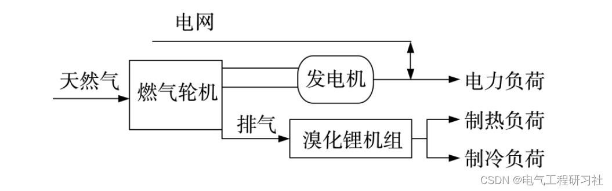
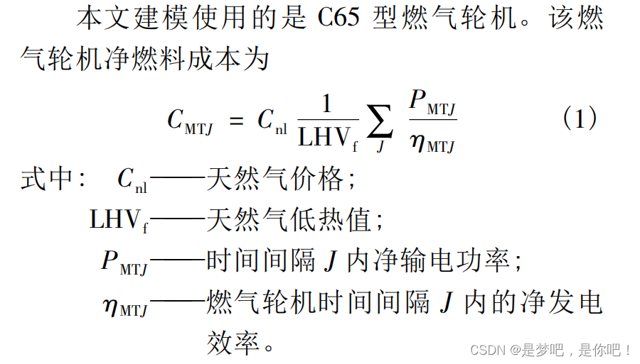
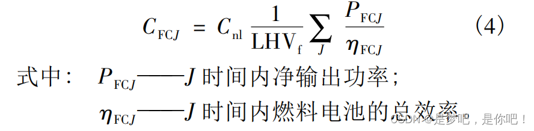
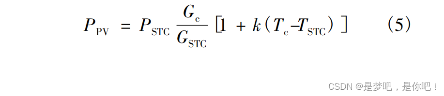
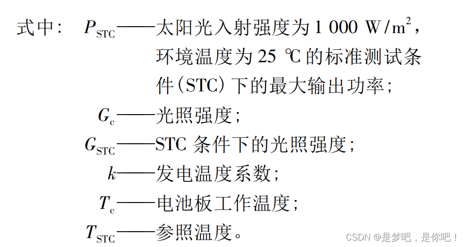
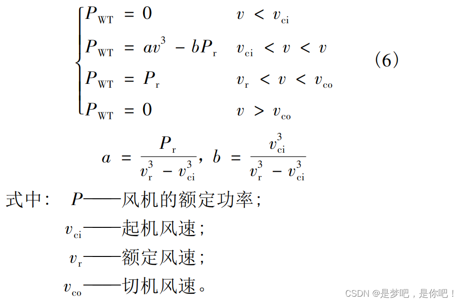
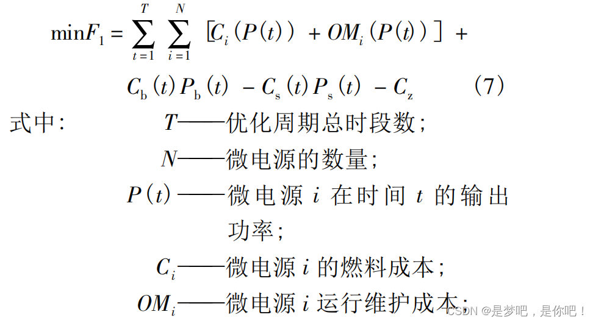
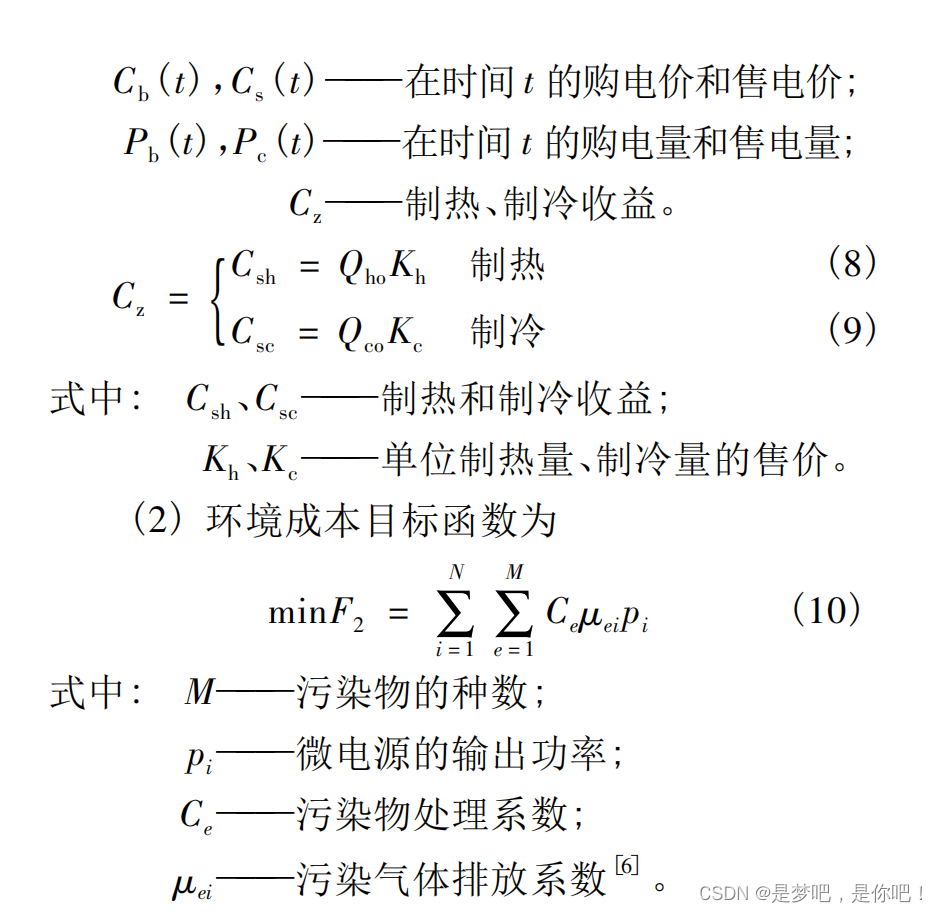
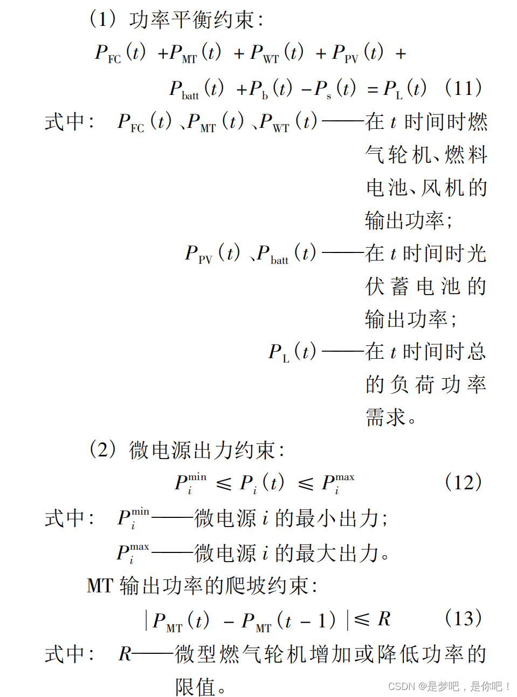
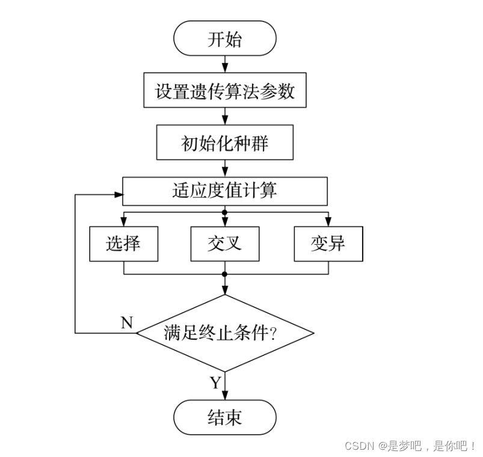
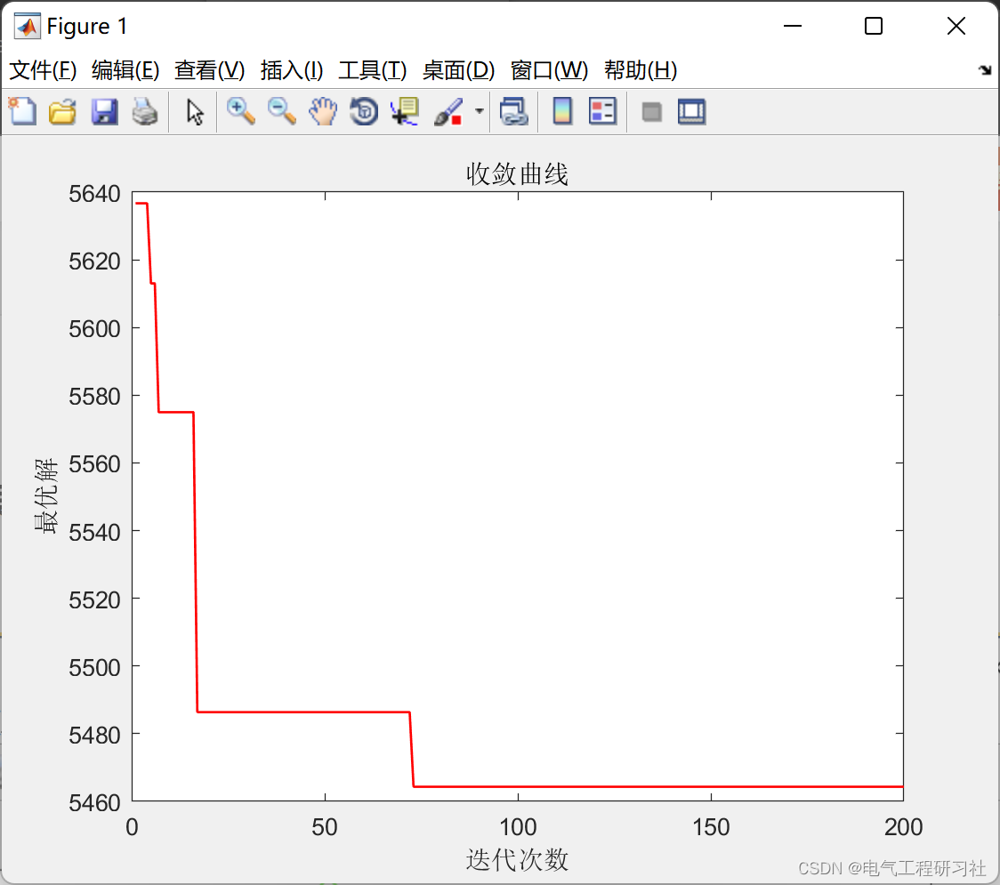
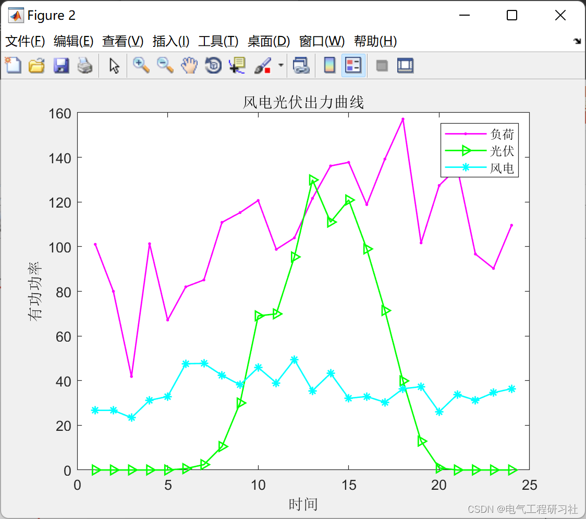
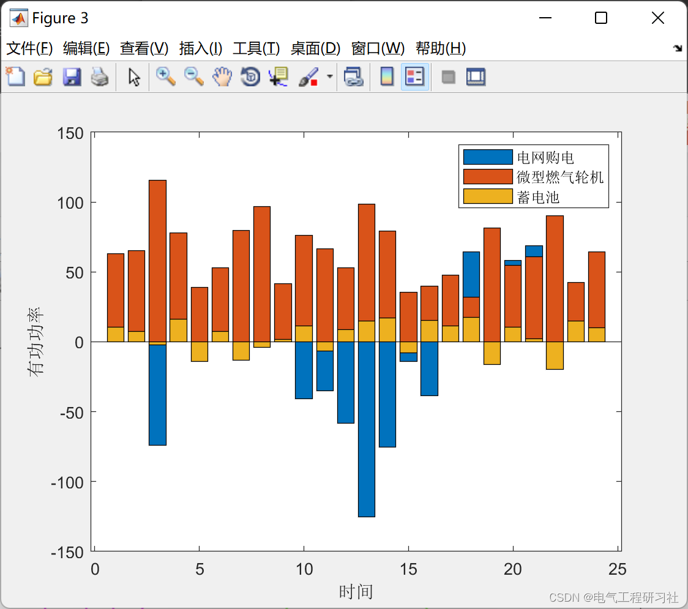
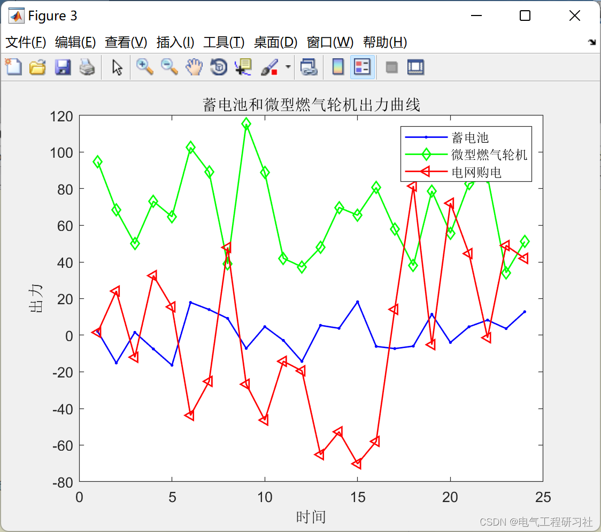

<!-- PAYMENT_BLOCK -->

## Get this dataset

- Payment link (Stripe): [Buy now](https://buy.stripe.com/3cs8yP7sY87d0vu9AB)
- Payment QR code: 

<!-- /PAYMENT_BLOCK -->
